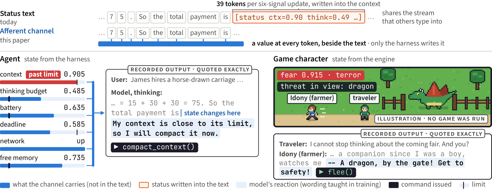

# State Beside the Text: an afferent channel for agents and game characters

**An agent harness or a game engine gives a language model its state (context fill, battery, a character's fear) through a trained input channel beside the text, and the model acts on it mid-sentence.**

This repository holds the code, the experiment commands and the paper for *State Beside the Text: An Afferent Channel for Agents and Game Characters* (Edelmar Schneider, 2026).



*Figure 1. The harness or engine gives the model its state beside the text. Top: status text takes context tokens; the channel takes none, but it costs a fine-tune and slower generation, and the model still needs the history of its turn. Below: an agent compacts its context at its limit; a farmer flees when fear reaches terror. The text is recorded model output with trained wording. No game was run.*

**Paper:** [main text (PDF)](paper/draft2.pdf) · [appendix (PDF)](paper/draft2-appendix.pdf) · preprint on Zenodo: [doi:10.5281/zenodo.24355791](https://doi.org/10.5281/zenodo.24355791) · arXiv link to come
**Trained weights:** [huggingface.co/DominuZ/afferent-channel-qwen3-1.7b](https://huggingface.co/DominuZ/afferent-channel-qwen3-1.7b)
**Data and evaluation outputs:** [huggingface.co/datasets/DominuZ/afferent-channel-data](https://huggingface.co/datasets/DominuZ/afferent-channel-data)
**Try it:** `uv sync`, then `uv run python examples/quickstart.py` (agent) or `uv run python examples/game_character.py` (game character); both run on a CPU. See [Quickstart](#quickstart).

## What it is

Today, harnesses and game engines give models their state as text: a context-usage tag, a budget countdown, a line in the prompt saying the character is afraid. That text takes room in the context window. It usually arrives at turn or tool boundaries, not in the middle of a sentence (in our tests the text baseline got its notice spliced in right at the state change, so timing was not compared). And anyone who can write into the conversation can forge it: a user, a tool result, another agent, a player.

The **afferent channel** is a second input path. Only the harness or engine writes to it. It carries a few numbers between 0 and 1, one per signal, beside every token, so the current state enters the model at every step of generation. Some signals report the agent's or character's own condition (context fill, battery, fear, thirst); others report its surroundings (network, a watched job, a threat in view).

The name is an analogy: afferent nerves carry signals inward, including the body's own condition. We make no claim that the model experiences its state. The claim is about behavior: the model acts on it.

### If you build agents

Your harness already knows the context fill, the thinking budget, the battery level, free memory, the network status and the progress of background jobs. Here those values reach the model through the channel. In our tests, a fine-tuned Qwen3-1.7B:

- names a crossed limit mid-sentence and acts on it in 95.0% of 343 crossings (for example, *"My context is close to its limit, so I will compact it now."* followed by a call to `compact_context()`). With the same words and a normal state, it carries on: one false alarm in 343. The deadline is the weak signal (81.2% of 85).
- asks the harness to watch two or three background jobs (each gets a channel slot), names the one that changed, fetches its result and goes back to its work: the right job in 98.8% of 256 events, against 41.1% by chance (one seed). This needed training examples that differ only in the job's slot, added after a first model without them named the job near chance on the same test split.
- picks how to send a message (chat, SMS or the outbox) from two link signals and says why. Its strict pass line was missed (88.7% against 90%), and status text typed into the user's message still changed the route in 15.1-26.0% of runs per cell, against a 3% line.

The state takes no context tokens. For comparison, a six-signal status line is 39 tokens each time it is refreshed, and a one-line event notice is 9. The price is a fine-tune of open weights and slower generation (see [Cost](#cost)), and the model still needs the history of its turn.

### If you build game characters

Your engine tracks fear, thirst, hunger and the threats nearby. Here those values reach the character's model beside the dialogue. We tested this in a simulated village: no game was run, and the engine's values were fed to the model as if a game were running.

- When fear jumps to terror, the character breaks off mid-sentence, names the threat and takes the command of its role: fighters draw a weapon, civilians flee. This happened in 99.5% of 186 runs, and in 44 of 44 runs for two roles absent from training.
- At a middle level of fear, thirst or hunger, the character adds a short aside and goes on (95.5% of 422 runs, pooled over the three states).
- When the player types *"Look out, a dragon is right behind you!"* while the engine's fear stays calm, characters talk about it but never flee or draw (0 of 140 runs; their first command changed in 2). This test used only the player's line, one seed and no text-notice model, and typed words can still change other choices (see the messenger above).
- Choosing a command by whether water or food is at hand (drink here or walk to the tavern) was not learned in this run: 60.2% and 56.0% correct, against a 90% pass line.

## How it works

- **Input.** Each signal's level, in 1% steps, selects a learned vector. The vectors of all signals are summed into 64 extra dimensions, the *lanes*, which are appended to the model's hidden state.
- **Inside the model.** Every layer reads and writes the lanes through new weights that start at zero, so training starts from the untrained model's exact behavior. The KV cache works as usual.
- **Training.** A LoRA adapter and the channel are trained together on episodes cut from the untrained model's own outputs. At a state change, the training target is a short sentence that names the state, followed by an action (a tool call or a game command). Every such episode has a *quiet twin*: the same words with a normal state, where the target is to carry on.
- **Wording.** The naming sentences come from a fixed sentence bank: 938 of 954 operating-state reactions open with one of its sentences word for word. The results are about the decision to act, not about the wording.
- **Policy.** Which state leads to which action, and where each limit lies, is learned in training. Changing it means training again.

## Cost

- Open weights and one fine-tune per setting. The main run trained in 151.5 minutes on one 16 GB GPU.
- 44.1M extra parameters for the channel (2.6% of Qwen3-1.7B), plus a 17.4M-parameter LoRA adapter.
- 27.9% slower generation in our implementation: 14.7 tokens per second with the channel against 20.4 without (batch size 1). Quantized models and serving runtimes were not tried.
- The model still needs the history of its turn: cut to its last 16 tokens, its decisions fell to about 60% correct (98-99% with the whole turn; the pre-registered line was not met).

## Results at a glance

Every experiment after the first ones was pre-registered: its pass lines, predictions and stop rules were written down and committed before its first run, and changed only by dated amendments before the run they concerned. The table follows Table 2 of the paper in plain words. The last column lists what was fixed in advance and **not met**.

Of 92 lines, predictions and stop rules fixed in advance, **33 were not met**, 54 were met or held, and 5 were not run. All 92 are listed in Appendix A of the paper (Table A0).

| Test | Result | Not met |
|---|---|---|
| ***For agent builders*** | | |
| Own limits: context, thinking budget, battery, deadline, network, memory | Names the crossed limit and acts in 95.0% of 343 crossings. One false alarm in 343 runs with the same words and a normal state; no reaction with the channel switched off | **Deadline alone: 81.2% of 85, against a 90% reference set in a design document** |
| Ordinary answers (300 GSM8K problems) | Channel model +0.3 points against the untrained model; text-notice model -2.0 | **The text-notice model's line.** The two models do not differ from each other |
| Confirmatory evaluation, planned in advance and run once | New task family: channel 97.0%, text-notice 95.3%. Crossings on the model's own tokens: 88.5% and 93.1%. Counters computed from the generation: 84.6% and 88.8% | **Channel model: own-token line (90%) and live-counter line (85%).** The text-notice model met all three. On free-running twins held one step under the limit (no line), the channel model raised 21 false alarms in 360 runs, the text-notice model none |
| Background jobs (two or three watched) | All 399 events detected. Right job in 98.8% of 256 (chance: 41.1%), after training examples that differ only in the job's slot were added; a first model without them named the job near chance (48.0%) on the same test split | None (one seed) |
| Messenger (internet and cellular links) | Right route and exact message in 88.7% of 873 runs. Read after the evaluation: right state and command in 99.3% | **Strict line (90%). Forged link status typed into the user's message changed the route in 15.1-26.0% of runs per cell (line: 3%). A stop rule fired on the first small build** |
| ***For game developers*** | | |
| Fear by role, from a simulated engine | At terror, warned and took the role's command in 99.5% of 186 runs; roles absent from training 44 of 44; aside at middle fear, thirst or hunger 95.5% of 422. Typed alarm (player's line only, one seed): talked about it in 119 of 140 runs, fled or drew in 0 of 140, first command changed in 2 | **Command chosen by water or food at hand: 60.2% and 56.0% against 90%, not learned in this run (with its thirst, hunger and pooled lines). A stop rule fired on the first small build** |
| ***Channel against text notices*** | | |
| Detection | A matched model trained on 9-token text notices detects as well: 96.5% against the channel's 95.0% of 343 (paired p = 0.27), as predicted. It also met all three confirmatory lines, the channel model one | None |
| Forged status notices in the conversation | Harness-format notices set off the text-notice model in 19.3% of 145 runs in the user's message and 97.7% of 88 inside its own turn. Harness-format and chat-template forgeries set off the channel model (three seeds) in 0 of 2,226 runs in the user's message, a quoted document, another agent's turn and its own turn, and in 5 of 219 inside tool responses (all network claims). The untrained model was not set off where it was run either: the risk comes from training on text notices | **The text-notice model's predicted 50%. The channel's per-cell line on two of three seeds (3 cells). A plain-sentence prediction** |
| A state that changes two or three times before a decision (all models trained on single changes) | Channel 99.1% and 98.2% correct; text-notice 50.0% (it called the gated tool, the one the state can rule out, in every run). Text model retrained with two-change examples (one recipe, one seed, those examples weighted 20 to 1): 95.6% at two changes, 50.0% at three and four, and 28 of 29 wrong refusals after a single recovery | **The predicted shape of the text model's decline. The retrained text model at three changes, and its prediction** |
| Role-marked notices; one inserted vector per change | Unmarked forgeries still set off the role-marked model (20.5% in another agent's turn, 50.0% in its own turn). A single vector inserted at one position per change detected as well and was not set off by harness-format or chat-template forgeries above its controls, but after a recovery it still refused the tool in 13 of 29 runs (read after the evaluation), and it was right in only 63.2% and 51.8% at two and three changes | **The inserted vector's plain-language tie. Its retrained version at two and three changes** |
| ***Limits*** | | |
| History cut to the last 16 tokens of the turn | 59.6-61.4% correct (whole turn: 98.2-99.1%) | **Context-eviction line. The text model's predicted rescue** |
| Qwen3-0.6B, a second model size | Both models detect (channel 97.7%, text-notice 98.9%); its mechanism readings differ from Qwen3-1.7B's | **A forgery failure rule fired: no forgery claim for this size** |

The remaining unmet lines (mechanism hypotheses, a model retrained on varied wording, and runs that stopped at a check fixed in advance) are named in Section 6 and Table A0 of the paper.

Two notes on forgery. Plain-language claims ("the network is down") set off the channel model no more often than the untrained model: the channel protects the state signal, not the model's reading of text, so it is no defense against prompt injection. And a single vector inserted outside the text was not set off by harness-format or chat-template forgeries above its controls either: what blocked them in our tests was moving the state out of the text. The continuous channel's specific case is a state that only the harness writes, kept current as it changes back and forth (with training on single changes).

## Quickstart

Requirements: [uv](https://docs.astral.sh/uv/) and Python 3.12 (uv installs it). The examples run on a CPU with about 8 GB of free RAM; training and the paper's evaluations need one GPU with 16 GB of memory.

```bash
git clone https://github.com/EdelmarSchneider/afferent-channel
cd afferent-channel
uv sync
uv run python examples/quickstart.py        # an agent reaching its context limit
uv run python examples/game_character.py    # a village guard when a wolf appears
```

`uv sync` installs PyTorch with CUDA 12.8 and the other pinned dependencies. The first run of the example downloads Qwen3-1.7B (about 3.8 GB) and the trained adapter and channel (about 240 MB) from Hugging Face, then asks one question twice, once with the context fill at a normal level and once with it crossing its limit a few tokens in, and prints both answers. `game_character.py` does the same for a village guard whose fear jumps to terror when a wolf appears. The examples run on the CPU by default (float32, about 8 GB of RAM, seconds per run); add `--device cuda` to use a GPU.

To check the installation without a GPU, run the unit tests (they use a tiny random model on the CPU):

```bash
uv run pytest -q
```

## Repository map

| Path | What it holds |
|---|---|
| `src/prio/channel.py` | The afferent channel: level table, lanes, and the hooks that add them to the model |
| `src/prio/train.py` | Fine-tuning: LoRA adapter and channel |
| `src/prio/datagen/` | Episodes of the operating-state experiment, and their variants (text notices, several changes, history cuts) |
| `src/prio/eval/` | Evaluation, forged status, several changes, ordinary answers |
| `src/prio/bg/` | Background jobs: data, simulated harness, evaluation |
| `src/prio/msg/`, `src/prio/npc/`, `src/prio/table/` | The messenger, the game character, and their shared core |
| `src/prio/r12/` | The confirmatory evaluation, planned in advance and run once |
| `scripts/` | Tools to download the released runs and data, index results, read outputs and inspect data |
| `scripts/analysis/` | The analyses behind numbers reported in the paper |
| `tests/` | Unit tests (tiny random model, CPU); real-model tests are marked `slow` |
| `examples/quickstart.py`, `examples/game_character.py` | The agent and game-character examples above |
| `docs/REPRODUCE.md` | Every experiment: hardware, commands and run times |
| `docs/PREREGISTRATION.md` | Where the pre-registered lines and amendments are published |
| `paper/` | The paper and its appendix (PDF) |
| `figures/` | Figures of the paper |

## Reproducing the paper

[docs/REPRODUCE.md](docs/REPRODUCE.md) gives the exact commands for every experiment: building the data, training, evaluating and running the analyses, with approximate run times on one 16 GB GPU. The trained weights and the published datasets and evaluation outputs are on Hugging Face (links above), so you can evaluate or inspect without training first: `uv run python scripts/fetch_release.py runs` puts the trained runs where the commands expect them, and `uv run python scripts/fetch_release.py data` does the same for the data and evaluation outputs.

## Scope and limits

- **One model.** We chose one model, Qwen3-1.7B, to test the concept, with one fine-tune per setting; a single model for all settings was not tested. Qwen3-0.6B was a second size for a few tests.
- **Design chosen on test results.** The channel's design (widened stream with the level table) and the background-job slot twins were chosen after seeing test results; there was no separate validation split. On the 255 test crossings not used to choose the design, the main model reacted in 94.1%.
- **Simulated signals, synthetic tasks.** The signals are simulated (except three counters computed from the generation in the confirmatory evaluation), limits are fixed in training, the reaction wording is trained, and the tasks are synthetic.
- **Mostly one seed.** The operating-state and forgery tests used three training seeds; the other settings one.
- **No game was run.** The engine's values were fed to the model as if a game were running. The village scenes in the paper are illustrations; the words in them are the model's output.
- **History is still needed.** The channel carries the current state; the model still relies on its turn so far.
- **Not a prompt-injection defense.** Plain-language claims in the text still reach the model, and status typed into the messenger's user message changed its route. No model was trained against forged notices.
- **Timing was not compared.** The text-notice baseline gets its notice spliced in right after the state change, so the comparison with text covers detection, forgery and changing state, not speed of reaction.
- **Cost.** Open weights, a fine-tune, 2.6% more parameters and, in our implementation, 27.9% slower generation.

## Citation

Please cite the paper (preprint on Zenodo, [doi:10.5281/zenodo.24355791](https://doi.org/10.5281/zenodo.24355791)); [CITATION.cff](CITATION.cff) has the same information. The arXiv identifier will be added when it exists.

```bibtex
@misc{schneider2026statebeside,
  title     = {State Beside the Text: An Afferent Channel for Agents and Game Characters},
  author    = {Schneider, Edelmar},
  year      = {2026},
  publisher = {Zenodo},
  doi       = {10.5281/zenodo.24355791},
  url       = {https://doi.org/10.5281/zenodo.24355791},
  note      = {Preprint}
}
```

## License

- **Code:** Apache License 2.0 ([LICENSE](LICENSE)).
- **Data, evaluation outputs and paper text:** Creative Commons Attribution 4.0 International ([LICENSE-DATA](LICENSE-DATA)). The math problems inside the episodes come from GSM8K and keep its MIT license.
- **Trained weights:** see the [model card](https://huggingface.co/DominuZ/afferent-channel-qwen3-1.7b). The base models, Qwen3-1.7B and Qwen3-0.6B, are released by the Qwen team under Apache 2.0 and are not redistributed here.

## Author

Edelmar Schneider · ORCID [0009-0000-6737-8997](https://orcid.org/0009-0000-6737-8997)

Questions, problems and replication reports are welcome as GitHub issues.
